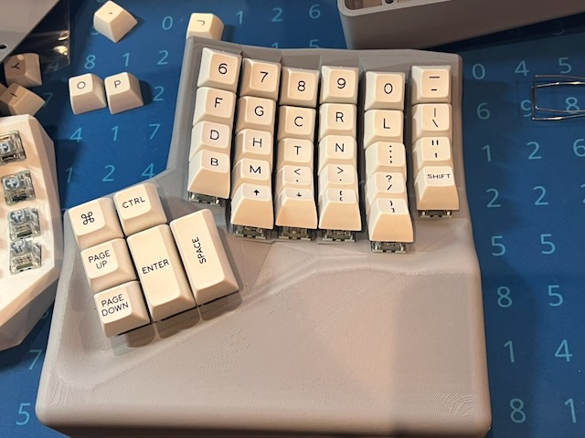

# Dactyl XLCC



A contoured, split keyboard case with a large tilted wrist rest and a slide-in
controller tray, generated in Rust with the
[Truck](https://github.com/ricosjp/truck) CAD kernel, which writes the STL
and 3MF files directly, without OpenSCAD.

**Ready to print:** the generated files are in [`models/`](models), as 3MF
(smaller, preferred by Bambu Studio and other modern slicers) and STL. Print
one of each part per hand; see Outputs below for what is what.

## Credits

This is a port of, and builds on, **[dactyl-cc](https://github.com/mjohns/dactyl-cc)
by Michael Johns** (with contributions by Leonardo Boss and TristanK-2055089).
The key layout, the bowl and thumb cluster geometry, the switch holes, the
walls, the screw inserts and the bottom plate all come from his C++/OpenSCAD
generator (`src/dactyl.cc`, `src/key_data.*`, `src/util/key.*` there); this
repository started as a faithful translation of it (see Validation below) and
was then changed as described in the sections marked "differs from the
OpenSCAD original".

dactyl-cc in turn takes its inspiration from the
[Dactyl](https://github.com/adereth/dactyl-keyboard) by Matthew Adereth and
the [Dactyl Manuform](https://github.com/abstracthat/dactyl-manuform) by Tom
Short.

The history of this repository starts at the commit that added the port to
[a fork of dactyl-cc](https://github.com/tommythorn/dactyl-cc).

## License

dactyl-cc does not come with a license, and this repository keeps it that
way: no license is granted here beyond what the authors of dactyl-cc have
granted. Ask before reusing the code or the models.

## Layout

```
.
├── Cargo.toml
├── src/
│   ├── geom.rs      # Shape (union of solids), primitives, booleans, 2D shadow
│   ├── key.rs       # switches, caps, connectors, `Key`   (port of util/key.*)
│   ├── key_data.rs  # key placement / bowl geometry      (port of key_data.*)
│   ├── main.rs      # case assembly + output             (port of dactyl.cc)
│   └── tray.rs      # controller tray and its dock in the back wall
└── build.sh
```

## Build and run

```
./build.sh                 # cargo build --release && generate ./out/*.{stl,3mf}
# or
cargo run --release -- --out out
```

The toolchain is pinned to stable in `rust-toolchain.toml` (one of Truck's
dependencies, `branches`, does not build on nightly).

Outputs (same file names as the OpenSCAD flow, each as `.stl` and/or `.3mf`):

| file | description |
| --- | --- |
| `left` / `right` | case halves |
| `bottom_left` / `bottom_right` | bottom plates |
| `tray_left` / `tray_right` | controller trays (Feather and TRRS jack) |
| `tray_nojack_left` / `tray_nojack_right` | controller trays (Feather only) |

Each file holds a single part, in mm. The 3MF files contain the same triangles
as the STL files, with every vertex stored once per shell, and are about 7x
smaller.

The committed copies in `models/` are updated by hand: run `./build.sh`, check
the files, then `cp out/* models/`. (`out/` itself is not tracked: the
triangulation varies slightly from run to run.)

Other flags:

* `--out DIR` – output directory (default: current directory)
* `--format LIST` – `stl`, `3mf` or `stl,3mf` (default: `stl`; `build.sh`
  writes both)
* `--sanity` – run self-checks of the geometry primitives
* `DACTYL_VERBOSE=1` – print details about handled boolean failures
* `DACTYL_PREVIEW=1` – also write `preview_tray_left.stl` and
  `preview_tray_nojack_left.stl`, the case with a tray in place (for checking the fit, not for printing)

A full generation takes ~10 seconds.

## How the model is represented

The original program produces OpenSCAD source that is a tree of `union`,
`hull`, `difference`, `projection` and `linear_extrude` nodes. The port maps
that tree onto Truck:

* **`Shape`** (`geom.rs`) is a list of convex solids. Unions are therefore free
  (no boolean is needed to combine shapes); the list is only collapsed when a
  real solid is required.
* **`hull()`** is a convex hull of the input points, computed with
  [`convexhull3d`](https://crates.io/crates/convexhull3d) and turned into planar
  triangle faces. Hull inputs are deduplicated because the same vertex often
  comes from several overlapping solids. (`quickhull` silently dropped hull
  vertices for inputs with a tiny axis extent, e.g. the 0.01 mm wall
  connectors, which produced wrong hulls.)
* **2D hulls** (`projection()`) use Andrew's monotone chain. `convexhull3d`
  rejects degenerate coplanar inputs, and `quickhull`'s 2D hull has the same
  vertex-dropping bug as its 3D version.
* **`cube` / `cylinder` / the cap frustums** are built from prism sweeps or
  explicit planar faces. Cubes are triangulated: `truck-shapeops` mis-handles
  quadrilateral prism faces when cutting triangular hull solids (e.g. the
  thumb-plate cut box left the thumb wall hulls uncut).
* **Screw posts are hollow tubes**, open at both ends (the reference screw hole
  only reaches z = 7.5 and leaves the top of the post capped), so a brass
  threaded insert can be fitted from either end. They are built directly as
  tubes (`tube` in `geom.rs`) and added after the screw holes are subtracted:
  cutting the bore with booleans gave cracked, non-manifold shells.
* **STL output is welded.** Each shell's vertices are merged within 4 µm and
  collapsed triangles dropped before writing (`welded_triangles`), because
  boolean cuts leave micron-sized sliver faces that otherwise show up in
  slicers as non-manifold edges. The right-hand files are the mirrored
  triangles of the left-hand ones.
* **`cylinder_smooth`** (screw holes in the case) is a revolved cylinder. Its
  B-rep only stores the three circle vertices from Truck's `whole_rsweep`, so
  its 2D hull is a triangle. The bottom-plate screw holes are therefore cut
  with the faceted `cylinder(height, radius, 30)` of the reference instead of
  a 2D hull of the smooth cylinder.
* **`projection() + linear_extrude()`** (only used for the bottom plate) is an
  exact 2D operation: every convex solid's shadow is its projected convex hull,
  the hulls are rasterized and their union outline is traced with marching
  squares, then extruded.
* **`difference()`** is done per convex solid (`and` with the inverted negated
  solid), which is far more reliable than subtracting from the already-unioned
  non-convex case.

## Wrist rest (differs from the OpenSCAD original)

The front walls (everything facing the user, from the pinky column to the
thumb cluster) and the right wall of the thumb cluster are replaced by a
hollow box with a tilted, gently curved top. In plan view the box is a
rectangle:

* from the left wall to the right most (back right) corner of the thumb
  cluster;
* forward to `WRIST_REST_EXTRA_DEPTH` (30.3 mm) in front of the front most
  (front right) corner of the thumb cluster. The case is about 180 x 185 mm.

The height of the top is given at its corners, relative to the highest point
of the front edge of the key plate (next to the thumb cluster, ~31.6 mm):
`WRIST_REST_RISE_BACK_LEFT` (+5 mm, in front of the pinky column),
`WRIST_REST_RISE_FRONT_LEFT` (-10 mm) and `WRIST_REST_RISE_FRONT_RIGHT`
(+10 mm, above the thumb keys' plate). The back right corner follows the thumb
cluster. In between, the four heights are blended bilinearly, which makes the
top a slightly twisted surface rather than a plane. Towards the rims it levels
off (over `WRIST_REST_LEVEL_OFF`, 15 mm), so it runs into the rounded top
edges without a crease. The top edges and the two front corners are rounded
(quarter circle, `WRIST_REST_RADIUS` = 8 mm).

Between that top and the edge of the key plate the surface follows a smooth
S curve (level at both ends): down to the bowl, which is up to 20 mm lower at
the pinky column, and up from or down to the thumb cluster. The curve is
`WRIST_REST_SLOPE_RUN` (2 mm) long per mm of height difference. Next to the
back of the thumb cluster there is no room for the whole curve, so the rim of
the box follows the thumb cluster there to meet the regular wall at its back
right corner.

The bottom plate follows automatically (it is the shadow of the case). There
are seven screw inserts: the four of the original that are not at the front,
two against the front wall of the wrist rest and one against its right wall.

## Controller tray (differs from the OpenSCAD original)

`tray.rs` generates a tray for an Adafruit Feather nRF52840 Express and a
PJ-320A style TRRS jack, and the dock for it at the right end of the back wall
(left half; the right half is mirrored).

* **Dock.** A notch through the back wall, open at the bottom, framed by
  straight jambs with a channel on each side and a lintel on top. It sits
  right next to the back right corner of the case (`TRAY_DOCK_FROM_CORNER`),
  where the side wall closes off the channel.
* **Fitting.** With the bottom plate off, the tray slides up into the notch from
  below. Flanges on both sides of its faceplate run in the channels, so the
  tray cannot be pushed in or pulled out; the bottom plate holds it up.
* **Faceplate.** Follows the (slightly angled) back wall, while the board and
  the jack point straight back, which keeps them clear of the D column
  switches. It has a slot as wide as the board, which the USB end of the board
  sits in, flush with the outside at its nearest corner, and a round hole for
  the barrel of the jack, which ends flush with the outside.
* **Feather.** Pressed straight down onto four pegs through its mounting
  holes, on standoffs. The USB end rests on the faceplate.
* **Jack.** Goes in upside down (pins up, for soldering): barrel first into its
  hole at an angle, then the back end down behind the lip. A drop of glue keeps
  it from lifting.

There are two variants. `tray_*.stl` is as described. `tray_nojack_*.stl` has
no jack: a plain faceplate with the Feather in the same place, which is the
side of the notch with the most headroom under the key plate. The battery
socket of the Feather is on its long edge, facing the corner of the case in
the left half and the free space where the jack would be in the right half.

All part sizes and clearances are constants at the top of `tray.rs`.

## Rounded exterior (differs from the OpenSCAD original)

The original walls meet the key plate with a chamfer: a flat strip from the
plate edge to the top of the wall. The outside of that strip is now a conic arc
through the same two end points (`WallProfile` in `main.rs`): it leaves the
plate along the plate's own slope and arrives at the wall top going straight
down, so plate, edge and wall are tangent continuous. Where the plate rises
towards the wall (the number row) the arc crests up to ~0.75 mm above the plate
edge before turning down.

The outside corners of the case (number row left and right, thumb cluster back
right) are swept around with extra slices instead of a single flat bevel. In
plan view the wall top follows a conic arc there that is tangent to the walls
on both sides of the corner, so the corner stays inside the lines of those
walls. The inside of the walls and the key plate are unchanged; the wall
positions (and so the bottom plate) only change at those corners, by a fraction
of a millimetre.

All curved surfaces are faceted; the number of segments is set by
`WALL_ROUND_STEPS`, `WALL_CORNER_STEPS`, `WRIST_REST_CORNER_STEPS` and
`WRIST_REST_SLOPE_STEPS` / `WRIST_REST_TOP_STEPS` in `main.rs`.

## Switch holes (differ from the OpenSCAD original)

The two rounded tabs that hold a switch in its hole have a radius of
`K_SIDE_NUB_RADIUS` = 1.15 mm (`key.rs`) instead of 1.0 mm, so each reaches
0.15 mm further into the hole.

## STL clean-up

Every shell in the STL files is closed, but the hulls and cuts leave two kinds
of degenerate triangles that slicers object to ("non-manifold edges", "reversed
faces"), and not on every run. `write_mesh_stl` removes both, per shell:

* fins: two triangles on the same three corners, back to back;
* needles: triangles whose corners are on one line. The neighbour across the
  long edge is split at the corner in the middle instead.

To check a file the way the slicer does:
`/Applications/BambuStudio.app/Contents/MacOS/BambuStudio --info out/left.3mf`
(or `.stl`) should print `manifold = yes`.

## Truck boolean robustness

`truck-shapeops` fails (usually returning `None`, sometimes panicking with
"shell is not oriented and closed") when solids share axis-aligned faces, which
happens constantly in this model (boxes on the same z plane, keys on the same
x/y plane). `subtract_with_nudge` retries with sub-0.05 mm translations and tiny
rotations about the negative solid's own centre. A cut is only accepted as
is when its mesh is closed: now and then a cut succeeds but leaves a micron
wide sliver that tessellates into a hole, and then the nudged cuts are tried
as well. Every boolean is wrapped in
`catch_unwind`; failed unions keep both solids side by side, failed subtractions
keep the solid uncut and are reported in the summary line.

## Validation

Done before the wrist rest was added (the front of the case, the screw
inserts, the corners and the switch tabs now differ on purpose). Compared against the STL files produced by the
OpenSCAD flow of dactyl-cc (its `things/` and `src/`):

* bounding boxes of all four files match the OpenSCAD output exactly (0.00 mm
  on the case, <0.1 mm on the plate);
* top-down silhouettes have an IoU of 0.9997 for the case halves and 0.9988
  for the bottom plates (rasterised at 0.2 mm); the five plate screw holes are
  round (30-gon) and match the reference holes pixel for pixel;
* horizontal cross-sections (z = 1 … 52 mm) have an IoU of 0.88 … 1.00;
* every hull point set was checked against the hull inputs parsed from the
  reference `left.scad` (419 hulls, all identical up to rounding);
* screw holes, the thumb-plate cut and all wall geometry are reproduced; the
  five screw posts are hollow tubes open at z = 0 and z = 10.

Known small differences:

* the bottom plate outline is traced on a 0.2 mm grid and simplified, so its
  outline can differ from the OpenSCAD plate by ~0.1 mm;
* STL triangle counts are higher than OpenSCAD's (hulls and the plate outline
  are triangulated by Truck), which is fine for slicing;
* a handful of disjoint solid pairs are still reported as failed subtractions
  when `DACTYL_VERBOSE=1`; they are detected (empty intersection) and skipped.
